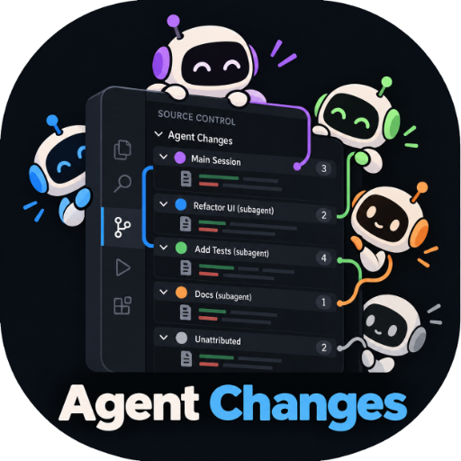
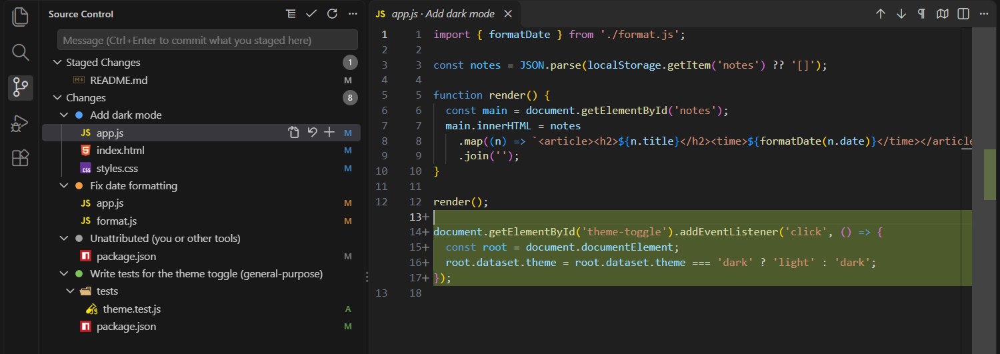
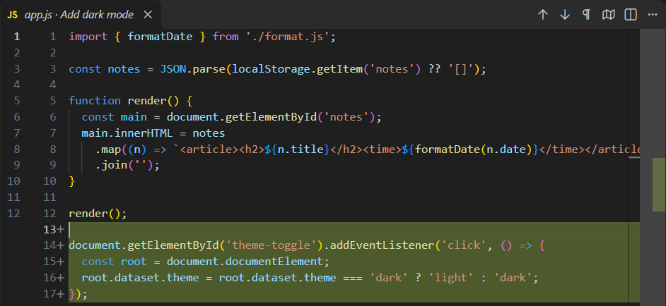
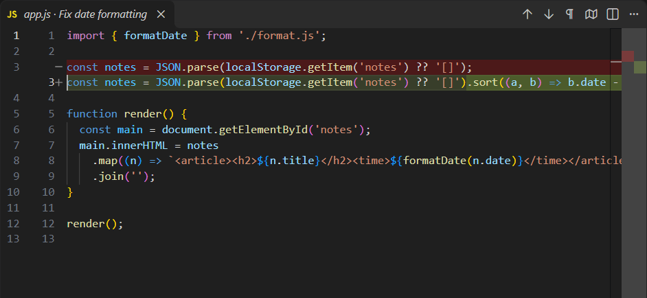
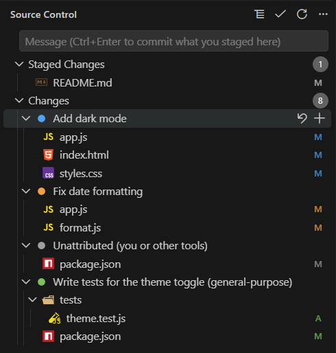

<p align="center">
  
</p>

<p align="center">
  <b>Running several Claude Code agents in one project? Source Control shows each agent's changes separately,<br>
  so you can review, commit or undo them one agent at a time.</b><br>
  No extra branches or worktrees: every agent keeps working in the same folder.
</p>

<p align="center">
  <a href="https://marketplace.visualstudio.com/items?itemName=aseel1.agent-changes"></a>
  
  
  
  
  
</p>

<p align="center">
  
</p>

---

## What it does

When several Claude Code agents work in the same project, VS Code's Source Control shows all of their edits in one mixed list. **Agent Changes** sorts that list by agent. Each agent gets its own collapsible group holding only the files, and only the lines, that agent changed. From there you can review, stage, commit or discard one agent's work without touching the others.

It also keeps the agents themselves from stepping on each other: when one Claude session runs a git command that would commit or throw away another session's unfinished work, Agent Changes stops the command and tells Claude how to act on its own changes only.

An **agent** is a Claude Code session (one chat, in the terminal or in the VS Code extension) or a subagent that session started.

## Why

Say you ask Claude to add a dark mode, and it hands the tests to a subagent. Meanwhile, in a second chat, another Claude session fixes the date formatting. All three edit your project at the same time, on the same branch, sometimes in the same file.

Without Agent Changes, Source Control shows one list of modified files, and a file two agents touched shows both agents' edits in a single diff. You can't tell which agent changed what, review one task on its own, or commit one task and leave the rest for later.

The usual answer is a separate copy of the project for each agent (a Git worktree). Agent Changes keeps one folder and one branch, and tells the agents' edits apart instead.

## Features

- 🗂️ **A group per agent.** Under **Changes**, each agent's files sit in their own collapsible group, marked with the agent's color. A session's group carries the session's title and follows renames. A subagent's group is named after the task it was given.
- 🔍 **Only that agent's lines.** Click a file to compare the last commit with that agent's edits alone, even when other agents changed the same file.
- ✅ **Stage, commit or discard one agent's work.** The buttons on an agent's group, or on one of its files, act on that agent's edits only. Everyone else's stay as they are. Commit with the usual message box.
- 🧹 **Discard All.** One button on **Changes** throws away everything that isn't staged, just like Git's. What you staged is kept.
- 🛡️ **Agents keep out of each other's work.** A session that runs `git add -A`, `git commit -a`, `git checkout .`, `git stash` or the like over another session's uncommitted changes is stopped, and told how to stage or undo only its own. [More below](#keeping-agents-out-of-each-others-work).
- 🙋 **Nothing goes missing.** Edits no agent made (your own typing, a formatter, a build step) appear in an **Unattributed** group.
- 🔒 **Local only.** No network, no telemetry. The record of who changed what lives in `.git/agent-changes/`, which Git never commits.

Two agents edited the same `app.js`. Clicking it under each agent shows only that agent's change:

<table>
  <tr>
    <th>Under <i>Add dark mode</i>: only the theme toggle</th>
    <th>Under <i>Fix date formatting</i>: only the sorting</th>
  </tr>
  <tr>
    <td></td>
    <td></td>
  </tr>
</table>

## Requirements

| | |
|---|---|
| **VS Code** | 1.90 or later |
| **Claude Code** | the CLI or the VS Code extension (tested with 2.1.x) |
| **Git** | the project must be a Git repository |
| **Node.js** | 18 or later, available as `node` on your PATH (the Claude Code hook runs with it) |

## Installation

### Option 1: VS Code Marketplace (recommended)

Open Extensions (`Ctrl+Shift+X`, or `Cmd+Shift+X` on macOS), search for **Agent Changes**, and click **Install**. Or install it from the [**Marketplace page**](https://marketplace.visualstudio.com/items?itemName=aseel1.agent-changes), or from a terminal:

```bash
code --install-extension aseel1.agent-changes
```

VS Code keeps it up to date from then on.

### Option 2: download the `.vsix`

For editors that don't use the VS Code Marketplace, or machines without internet access.

1. Open the [**latest release**](https://github.com/aseel1/agent-changes/releases/latest) and download `agent-changes-<version>.vsix` under **Assets**.
2. In Extensions, click **`…`** at the top of the panel, choose **Install from VSIX…**, and pick the downloaded file. Or from a terminal:
   ```bash
   code --install-extension agent-changes-<version>.vsix
   ```

### Option 3: build from source

```bash
git clone https://github.com/aseel1/agent-changes.git
cd agent-changes
npm install
npm run package                      # creates agent-changes-<version>.vsix
code --install-extension agent-changes-<version>.vsix
```

## Quick start

1. **Open your project** (a Git repository) in VS Code.
2. **Turn it on for the repository:** open the Command Palette (`Ctrl+Shift+P` / `Cmd+Shift+P`) and run **Agent Changes: Enable for This Repository**.
3. **Restart Claude Code sessions** already running in that repository so they load the hook. New sessions pick it up automatically.
4. **Open Source Control** (`Ctrl+Shift+G`) and use Claude as usual. Each agent's changes appear under **Agent Changes** as they happen. The first time, you'll be asked whether to show [colored dots](#the-colored-dots) for agents.

> [!TIP]
> Agents appear as groups only when Source Control is in **tree view**. Agent Changes switches to it the first time it runs. If you see a flat list, click the tree button in the Agent Changes title bar.

<details>
<summary><b>What does "Enable for This Repository" change?</b></summary>
<br>

- Creates `.git/agent-changes/`, where all tracking data lives. It sits inside `.git`, so it is never committed.
- Copies the hook script, and the guard and `cli.js` it uses, to `~/.claude/agent-changes/`.
- Adds the hook to `<repo>/.claude/settings.local.json`, Claude Code's personal settings file for the project. Your existing settings are kept.

The hook records nothing in repositories where `.git/agent-changes/` doesn't exist, so you can also register it once in `~/.claude/settings.json` to cover Claude sessions started from any folder.
</details>

## Using it

<p align="center">
  <br>
  <sub>Hover an agent (or a file) for its Discard and Stage buttons.</sub>
</p>

| Where | What you can do |
|---|---|
| **Click a file** under an agent | Diff of the committed file against **only that agent's changes** |
| **File row** buttons | Open file · Discard · Stage, for that agent's changes only |
| **Agent row** buttons | Discard or stage **everything** that agent did |
| **Changes** header | Discard all · Stage all |
| **Staged Changes** | Everything staged, together like the Git view. Click a file to see exactly what will be committed; hover it to see which agent it came from |
| **Message box** + ✓ (or `Ctrl+Enter`) | Commit what you staged |
| **`…`** menu | Reset tracking (forget who changed what; your files are untouched) |

Staging writes exactly *the committed file plus this agent's lines* into the Git index, so each commit can hold one agent's work. Discarding rewrites the file with that agent's lines removed and everyone else's kept. **Discard All** works like Git's: every file under Changes goes back to its staged version (or the last commit), and staged work is kept.

The Git view keeps working next to it. Staging in either one shows up in both.

### How agents are named

| Agent | Name shown |
|---|---|
| Main session | Its Claude Code session name (`claude -n "…"` or `/rename`, which updates live), otherwise the title Claude Code generates, otherwise your first prompt |
| Subagent | The task description it was launched with, plus its type, e.g. *Write tests for the theme toggle (general-purpose)* |
| Unattributed | Changes no agent made: your own edits, formatters, other tools |

### The colored dots

VS Code takes folder icons from your file icon theme, so drawing a colored dot instead of a folder icon for each agent means changing the icon theme. Agent Changes **asks once**, the first time agents appear in Source Control:

- **Show Dots** switches to **Your Icon Theme + Agent Changes Dots**: an exact copy of the theme you already use (Seti, vscode-icons, …) with the dots added. Everything else, the Explorer included, looks the same.
- **Keep Folder Icons** leaves your theme alone. Agents then show with a regular folder icon.

You can change your mind any time with the `agentChanges.agentFolderIcons` setting. Turning it off, or uninstalling the extension, puts your own theme back.

## Keeping agents out of each other's work

Claude Code sessions don't know about each other. A session that finishes its task and runs `git add -A` also stages whatever another session is in the middle of, and one that cleans up with `git checkout .` throws that work away.

Agent Changes knows whose changes are whose, so its hook checks git commands before they run. When a command would reach another session's uncommitted changes, the hook blocks it and Claude gets the reason, for example:

```text
Agent Changes blocked this command, so none of it ran: `git add -A` would stage uncommitted
work that another Claude session made in this folder:
- "Fix date formatting" (another session): app.js, format.js

To stage only this session's changes (only your lines, even in files the other session
changed too), run:
  node "~/.claude/agent-changes/cli.js" stage --session 9ff6d679-…
then commit without -a and without file names: git commit -m "<message>"
```

In testing, Claude reads this, stages its own changes with the given command and commits only those. The other session's work stays where it was.

| Blocked when it would reach another session's uncommitted changes | |
|---|---|
| Stage or commit them | `git add` (`-A`, `.`, folders, files), `git commit -a`, `git commit <files>` |
| Erase them | `git checkout -- <files>`, `git checkout .`, `git restore`, `git reset --hard`, `git clean -f`, `git rm -f`, `git checkout -f`, `git switch --discard-changes` |
| Move them out of the folder | `git stash` |

It works for commands Claude runs in **Bash** and in **PowerShell**. Agents get a small command for acting on their own session's changes only:

```bash
node ~/.claude/agent-changes/cli.js status  --session <id>              # what is mine, what is others'
node ~/.claude/agent-changes/cli.js stage   --session <id> [files...]   # stage only my lines
node ~/.claude/agent-changes/cli.js discard --session <id> [files...]   # undo only my changes
```

- A session's **own subagents** count as part of its work, so the main session can commit what its subagents did.
- **Unattributed** changes (yours, or other tools') aren't guarded.
- If you do want everything in one commit, **tell Claude**. The message tells it to put `AGENT_CHANGES_ALLOW=1` in front of the command when you ask for that.

## Settings

| Setting | Default | Description |
|---|---|---|
| `agentChanges.agentFolderIcons` | `false`, until you answer the one-time question | Show each agent's colored dot instead of a folder icon (uses a copy of your icon theme, see [The colored dots](#the-colored-dots)). |

## Privacy

- Everything stays on your machine. The extension makes **no network requests** and collects **no telemetry**.
- The hook stores copies of the files agents change in `.git/agent-changes/`. Delete that folder, or run **Reset Tracking**, at any time.
- To follow session renames, the extension reads the title entries that Claude Code appends to the session's transcript file. It reads nothing else from transcripts.

## Troubleshooting

<details>
<summary><b>Nothing shows up under Agent Changes</b></summary>
<br>

1. Make sure you ran **Agent Changes: Enable for This Repository** in this repository.
2. Restart the Claude Code session. Sessions only load hooks when they start.
3. Check that `node --version` works in a terminal. The hook runs with Node.js.
4. Was the session started from a different folder? Hooks are registered per repository. Start Claude inside the repository, or register the hook in `~/.claude/settings.json` (see *What does "Enable" change?*).
</details>

<details>
<summary><b>I see a flat list instead of a group per agent</b></summary>
<br>

Switch Source Control to tree view: click the tree button in the Agent Changes title bar, or `…` → **View & Sort** → **View as Tree**.
</details>

<details>
<summary><b>An agent's change shows up as Unattributed</b></summary>
<br>

Agent Changes can only credit what the hook saw. Changes made by your own edits, by background processes an agent started (a dev server, a watcher), or by two agents' shell commands running at the exact same moment are shown as Unattributed.
</details>

<details>
<summary><b>My file icons look different</b></summary>
<br>

Set `agentChanges.agentFolderIcons` to `false`, or pick your usual theme in **Preferences: File Icon Theme**. See [The colored dots](#the-colored-dots).
</details>

## How it works

<details>
<summary>The details, for the curious</summary>
<br>

A [Claude Code hook](https://code.claude.com/docs/en/hooks) runs before and after every `Edit`, `Write`, `MultiEdit`, `NotebookEdit`, `Bash` and `PowerShell` call. It snapshots the affected files and appends an event to `.git/agent-changes/log.jsonl`, tagged with the session id and, for subagents, the `agent_id` and `agent_type` Claude Code passes to hooks. For shell commands, it compares `git status` before and after the command. When the `Agent` tool finishes, its description becomes the subagent's name.

Before a shell command that looks like one of the guarded git commands, the hook works out which files it would stage, stash or erase (asking git itself, with `--dry-run` where git has one), checks who owns the changes in them, and blocks the command with a [`deny` decision](https://code.claude.com/docs/en/hooks) if another session does. Claude Code passes the reason on to Claude.

The extension replays that log into a line-level ownership model of each changed file:

- Every changed line remembers who added it and who removed it, so each agent's version of a file can be rebuilt from the committed text plus only its lines.
- An agent that started from an older copy of a file (parallel agents do) is credited only with what it actually changed.
- When one agent edits lines another agent wrote, the later agent's view includes the edit it built on, so every view is still a coherent file. Both agents list the file, and the tooltip says who else changed it.
- After a commit, the committed changes become the new baseline and the rest keep their owners.

Session renames and generated titles are written to the session transcript without any hook firing, so the hook records where each transcript is, and the extension follows those files, reading only what was appended.
</details>

## Known limitations

- Two agents running **shell commands at the same moment** can't be told apart. Files those commands change show as Unattributed.
- Changes made by **background processes** an agent started show as Unattributed.
- **Binary files** and files over 8 MB are credited whole to their last writer.
- Agents still **share one folder**: an agent running a build or tests sees the other agents' half-finished edits. Use worktrees when that matters.
- VS Code sorts the agent groups **alphabetically**, not by when each agent started.
- The git guard is a **safety net, not a lock**. It reads the usual forms of the commands above. Scripts, aliases, or tools that change files without git get through. It also protects one session's work from other sessions, not two subagents of the same session from each other.
- This is a **preview**, tested mostly on **Windows**. macOS and Linux should work, and reports are welcome.

## Uninstall

1. Uninstall **Agent Changes** from the Extensions view. Your own icon theme is restored.
2. In each repository you enabled, remove the hook entries that mention `agent-changes-hook.js` from `.claude/settings.local.json`, and delete `.git/agent-changes/`.
3. Delete `~/.claude/agent-changes/`. Do this **after** step 2, or Claude Code will report a missing hook script.

## Development

```bash
npm install
npm test            # unit tests + end-to-end tests that drive the real hook against a temp repo
npm run package     # builds agent-changes-<version>.vsix
```

| Path | What's there |
|---|---|
| `hook/agent-changes-hook.js` | The Claude Code hook (plain Node.js, no dependencies) |
| `src/engine/` | Log replay, the line ownership model, Git plumbing, hook installation |
| `src/extension.ts` | The Source Control view, commands and decorations |
| `src/guard.ts` | The check the hook runs before git commands |
| `src/cli.ts` | The command agents run to stage or undo only their own changes |
| `src/iconTheme.ts` | The icon theme copy that draws the agent dots |

Issues and pull requests are welcome.

## Disclaimer

Agent Changes is an independent project. It is not affiliated with or endorsed by Anthropic. *Claude* and *Claude Code* are trademarks of Anthropic.

## License

[MIT](LICENSE) © 2026 Aseel Shaheen
